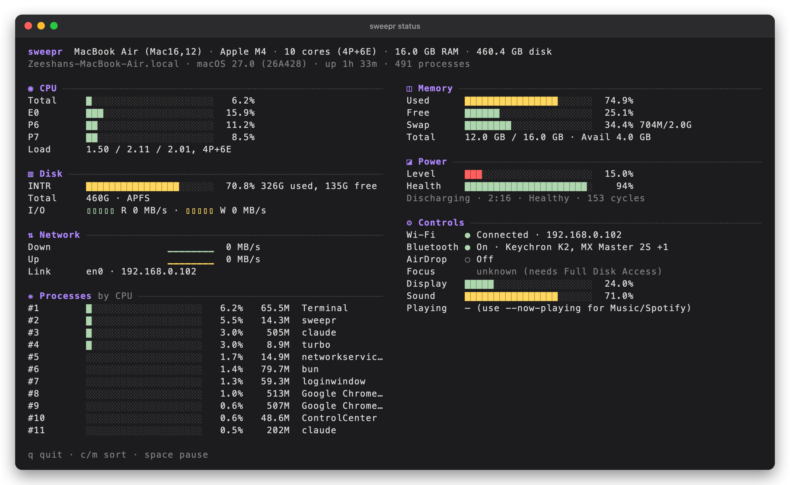
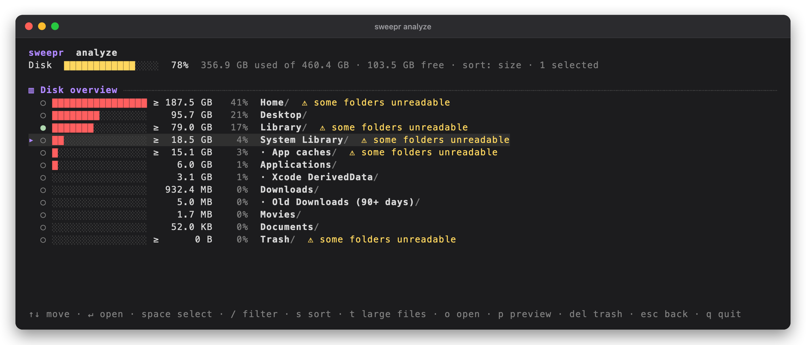
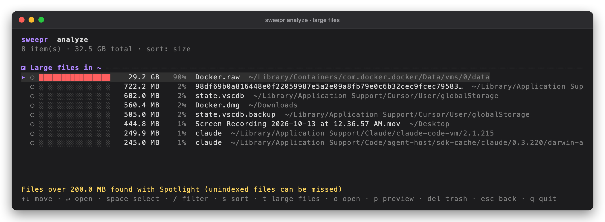
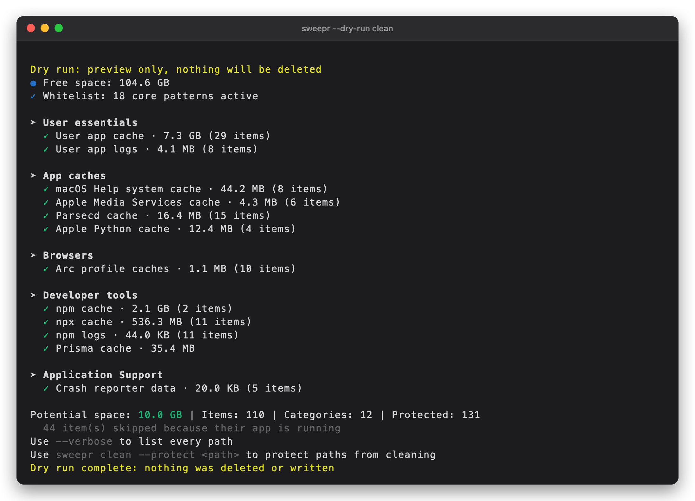
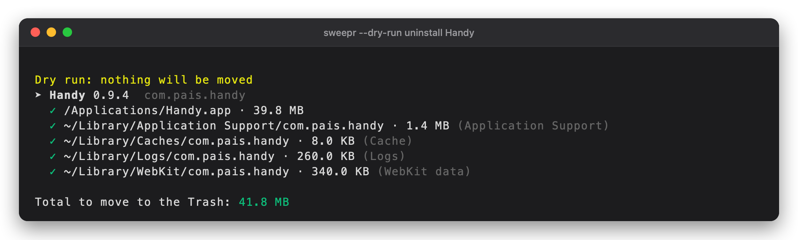
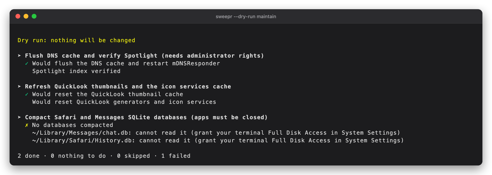

# sweepr

Monitor, clean, analyze and maintain your Mac from the terminal. One small Rust
binary, no runtime dependencies.

```
sw status       live dashboard: CPU, memory, disk + I/O, network, controls, processes
sw clean        deep clean: caches, logs, leftovers, orphaned app data
sw analyze      disk analyzer: where did the space go, find large files
sw uninstall    remove an app with its preferences, caches and LaunchAgents
sw maintain     flush DNS, refresh QuickLook/icons, compact databases
```

## Screenshots

<table>
  <tr>
    <td width="50%"><a href="docs/status.png"></a><br><b>Live dashboard</b> — <code>sw status</code>: Mac details, CPU with P/E cores, memory, disk and I/O, network, power, Control Center-style controls and top processes</td>
    <td width="50%"><a href="docs/analyze.png"></a><br><b>Disk analyzer</b> — <code>sw analyze</code>: where the space went, as a share of the disk, with unreadable folders flagged</td>
  </tr>
  <tr>
    <td width="50%"><a href="docs/analyze-large-files.png"></a><br><b>Large files</b> — press <code>t</code> in the analyzer to list the biggest files and the folder each one is in</td>
    <td width="50%"><a href="docs/clean.png"></a><br><b>Deep clean preview</b> — <code>sw --dry-run clean</code>: caches, logs and leftovers with sizes; nothing is deleted or written</td>
  </tr>
  <tr>
    <td width="50%"><a href="docs/uninstall.png"></a><br><b>Smart uninstaller</b> — <code>sw --dry-run uninstall Handy</code>: the app plus its preferences, caches, logs and LaunchAgents</td>
    <td width="50%"><a href="docs/maintain.png"></a><br><b>System maintenance</b> — <code>sw --dry-run maintain</code>: DNS flush, QuickLook/icon refresh and database compaction, previewed</td>
  </tr>
</table>

Captured from a real run on an M4 MacBook Air, in read-only mode where a command can change anything.

## Install

macOS only. Tested on macOS 27 / Apple Silicon (Intel and older macOS untested).
You need a Rust toolchain: `curl https://sh.rustup.rs -sSf | sh` (or `brew install rust`).

```sh
cd ~/Desktop/sweepr
cargo install --path . --locked      # builds a release binary into ~/.cargo/bin
sw --version                         # check it works
```

If `sw` is "not found", add Cargo's bin folder to your `PATH`:

```sh
echo 'export PATH="$HOME/.cargo/bin:$PATH"' >> ~/.zshrc && source ~/.zshrc
```

Try it without installing: `cargo run --release -- status`.
Update after changing the code: run the `cargo install` line again.
Uninstall: `cargo uninstall sweepr && rm -rf ~/.config/sweepr`.

## Run

Use a real terminal (Terminal, iTerm2, Ghostty); the interactive screens need a TTY.
Do not run it with `sudo`: `clean` and `uninstall` refuse, because they would act on root's home.
`maintain` asks for your password itself when a task needs it.

**Start here, in this order:**

1. `sw status` to look around. Quit with `q`.
2. `sw --dry-run clean` to preview. It deletes and writes nothing; add `--verbose`
   to list every path.
3. `sw clean` when you like what you saw. It shows the total and asks `[y/N]`.
4. `sw analyze` to see what is using the disk.

### Dry run: change nothing

`--dry-run` (or `-n`) works on every command, before or after the command name:

```sh
sw --dry-run clean        # same as: sw clean --dry-run
sw -n uninstall Slack
sw -n maintain
sw -n analyze             # browse only: Del shows what it would trash, o/p/f are off
```

A dry run only reads. It deletes, moves, writes and changes nothing: no files in your
home folder, no whitelist edits (`--protect` just reports what it would do), no
`sudo`, no DNS flush, no QuickLook reset, no SQLite connection (database sizes are read
from the file header). `sw status` never writes either way. This was checked by
running the commands under a macOS sandbox profile that denies all file writes.

### Full Disk Access (recommended)

macOS hides some folders (Safari and Messages data, Trash, parts of Library) from
terminals. Without access, sweepr tells you what it could not read instead of
guessing. To grant it: **System Settings → Privacy & Security → Full Disk Access**,
enable your terminal app, then restart the terminal.

## Commands

### `sw status`

| Key | Action |
|---|---|
| `q` / `Esc` | quit |
| `c` / `m` | sort processes by CPU / memory |
| `space` | pause |

Panels: CPU (per core, P/E cores), memory and swap, disk usage and read/write rates,
network per interface, **Controls** (Wi-Fi, Bluetooth, AirDrop, Focus, display
brightness, sound volume, now playing), top processes.

```sh
sw status --json                  # one snapshot
sw status --watch --interval 2s   # newline-delimited JSON stream
sw status --now-playing           # also show Music/Spotify (macOS asks permission once)
```

Controls are read-only, and anything macOS will not reveal shows as unknown, never
as off: the Wi-Fi network name is hidden by macOS privacy, Focus needs Full Disk
Access, and Chrome/Safari media is not readable (Music and Spotify only).

### `sw clean`

```sh
sw clean --dry-run                   # preview only
sw clean                             # scan, confirm, delete
sw clean --yes                       # no prompt (required in scripts)
sw clean --only browsers --only dev  # selected sections (prefix match)
sw clean --protect '~/Library/Caches/Foo*'   # whitelist a path or glob
sw clean --unprotect '~/Library/Caches/Foo*'
sw clean --whitelist                 # show active protections
```

Sections: User essentials, App caches, Browsers, Developer tools, Application
Support, App leftovers (orphaned data of apps that are gone). Caches of running
apps are skipped.

### `sw analyze [PATH]`

No path opens an overview of your Mac; a path opens that folder.

| Key | Action |
|---|---|
| `↑↓` `j k` | move |
| `enter` / `→` | open folder |
| `esc` / `←` | back (quits at the first screen) |
| `space` | select (then act on all selected) |
| `/` | filter by name (`esc` clears) |
| `s` | sort: size, name, modified |
| `t` | large files under here (default 100 MB) |
| `o` / `p` / `f` | open / Quick Look preview / reveal in Finder |
| `del` or `d` | move to Trash (asks first; only `y` confirms) |
| `r` | refresh |
| `q` | quit |

```sh
sw analyze ~/Developer --min-size 500MB
sw analyze --json ~/Library          # sizes as JSON
```

Deleting only ever moves items to the Trash, only inside your home folder, and never
a system folder (Desktop, Documents, Library, ...) itself. Empty the Trash to
reclaim the space.

### `sw uninstall [APP...]`

```sh
sw uninstall                 # pick from a searchable list (space select, / search)
sw uninstall --list          # installed apps with sizes
sw uninstall Slack --dry-run # show exactly what would be removed
sw uninstall Slack           # remove it (asks first)
```

Finds the app's preferences, caches, containers, group containers, extension data,
LaunchAgents and recent-documents lists from its bundle id and name variants, stops
its launch agents, and moves everything to the Trash. Running apps are refused,
Homebrew Cask apps are pointed to `brew uninstall --cask --zap`, and files that need
administrator rights are listed but not touched.

### `sw maintain`

```sh
sw maintain --list
sw maintain --dry-run
sw maintain --only quicklook      # dns | quicklook | databases
```

DNS flush needs your password (run it in a terminal). Database compaction needs
Safari/Messages closed and Full Disk Access; it checks integrity first and skips
anything over 100 MB.

## Safety model

Every deletion candidate passes the same gate: absolute path, no `..`, no control
characters, critical-path denylist, protected app/bundle lists, whitelist,
running-owner deferral, then sizing. Removal re-validates and
requires the same device/inode that was scanned. Symlinks are unlinked, never
followed. Orphan detection fails closed if any installed app's identity cannot be
read. Unreadable data is reported, never counted as empty.

Config lives in `~/.config/sweepr/`.

## Development

```sh
cargo test          # 100+ tests, including temp-home end-to-end runs
cargo clippy --all-targets
```

## License

GPL-3.0-or-later. See `LICENSE`.
